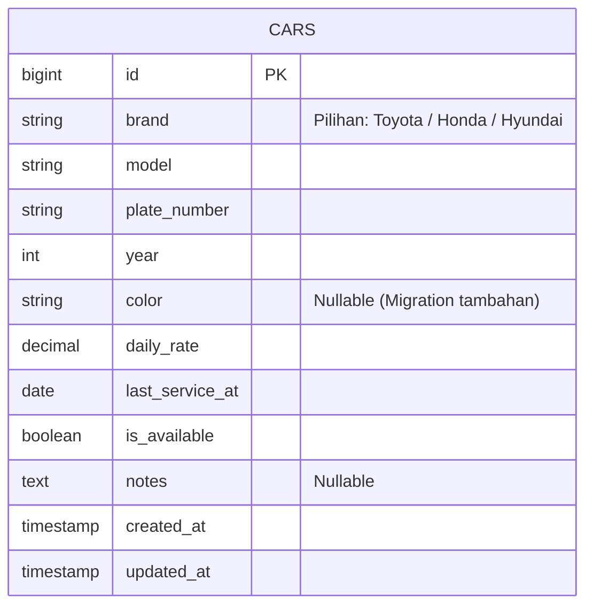

# Manajemen Rental Mobil (UTS Web Development)

Aplikasi web CRUD sederhana berbasis Laravel untuk pengelolaan data armada mobil rental.

## Identitas Mahasiswa

| Parameter | Keterangan |
| :--- | :--- |
| **Nama Lengkap** | Muhammad Hari Fazrian |
| **NIM** | 2457401023 |
| **Digit Terakhir NIM** | 3 |
| **Tema** | Rental Mobil |
| **Nama Aplikasi** | Manajemen Rental Mobil |
| **Nama Database** | `uts_2457401023` |
| **Nama Repository** | `uts-laravel-2457401023` |
| **Jumlah Data Seeder** | 13 data mobil (`10 + 3`) |

## Struktur Tabel `cars` & ERD



### Daftar Kolom Tabel `cars`

| Nama Kolom | Tipe Data | Keterangan | Asal Migration |
| :--- | :--- | :--- | :--- |
| `id` | `bigint` (PK) | Auto increment primary key | Migration 1 (`create_cars_table`) |
| `brand` | `string` | Merk mobil (`Toyota`, `Honda`, `Hyundai`) | Migration 1 (`create_cars_table`) |
| `model` | `string` | Nama model mobil (contoh: `Avanza`, `Brio`, `Creta`) | Migration 1 (`create_cars_table`) |
| `plate_number` | `string` | Nomor polisi kendaraan (contoh: `B 1234 KJA`) | Migration 1 (`create_cars_table`) |
| `year` | `integer` | Tahun keluaran kendaraan (contoh: `2021`) | Migration 1 (`create_cars_table`) |
| `daily_rate` | `decimal(12,2)` | Tarif sewa per hari dalam Rupiah (contoh: `350000`) | Migration 1 (`create_cars_table`) |
| `last_service_at` | `date` | Tanggal servis berkala terakhir (`YYYY-MM-DD`) | Migration 1 (`create_cars_table`) |
| `is_available` | `boolean` | Status ketersediaan sewa (`true` / `false`) | Migration 1 (`create_cars_table`) |
| `notes` | `text` (nullable) | Catatan tambahan kendaraan (opsional) | Migration 1 (`create_cars_table`) |
| `color` | `string` (nullable) | Warna kendaraan (contoh: `Putih`) | Migration 2 (`add_color_to_cars_table`) |
| `created_at` | `timestamp` | Waktu data dibuat | Migration 1 (`create_cars_table`) |
| `updated_at` | `timestamp` | Waktu data terakhir diperbarui | Migration 1 (`create_cars_table`) |

## Langkah Instalasi

1. Clone repository ini ke komputer lokal:
   ```bash
   git clone https://github.com/USERNAME/uts-laravel-2457401023.git
   cd uts-laravel-2457401023
   ```
2. Instal dependensi PHP melalui Composer:
   ```bash
   composer install
   ```
3. Salin file `.env.example` menjadi `.env` dan buat application key:
   ```bash
   cp .env.example .env
   php artisan key:generate
   ```
4. Buat database MySQL/MariaDB dengan nama `uts_2457401023`, lalu pastikan konfigurasi `.env` sesuai:
   ```ini
   DB_CONNECTION=mysql
   DB_HOST=127.0.0.1
   DB_PORT=3306
   DB_DATABASE=uts_2457401023
   DB_USERNAME=root
   DB_PASSWORD=
   ```
5. Jalankan migration beserta seeder (13 data mobil):
   ```bash
   php artisan migrate --seed
   ```
6. Jalankan server pengembangan lokal:
   ```bash
   php artisan serve
   ```
7. Buka aplikasi di browser pada alamat `http://127.0.0.1:8000`.

